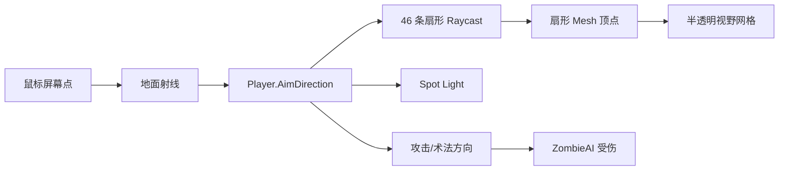
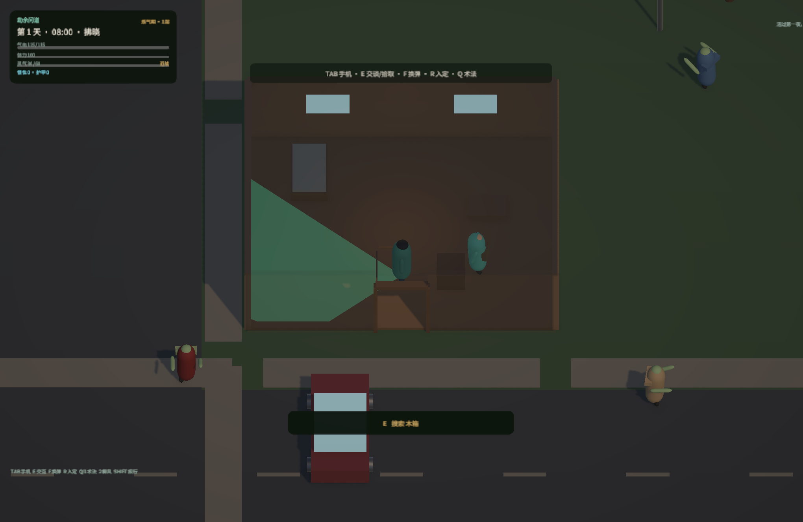
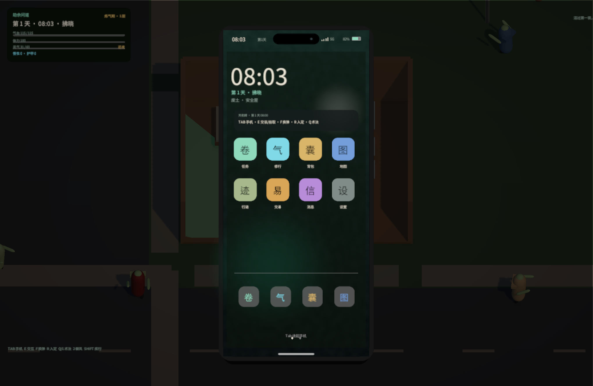

# Unity 落地方案

技术方向：**Unity 6.4 + URP，2.5D 俯视、可进入建筑、有视野范围、手机式拟真 UI**。本文只描述当前 Unity 主工程。

工程位置：`unity/AshenDao`（Unity 6.4 / URP 17）。

> 工程已在 **Unity 6.4 Editor 的 Play Mode** 中跑通并截图（本机 Personal 许可证激活；第一次启动需要处理模板依赖，见下）。当前：**0 warning / 0 error**，**52/52** 项纯 C# 断言通过，Play Mode 冒烟 **0 个游戏错误**。

## 1. 打开与运行

1. 用 Unity Hub 添加 `unity/AshenDao`。
2. 编辑器版本：**6000.4.2f1**（Unity 6.4；同 6.x LTS 一般可升级打开）。
3. 打开 `Assets/Scenes/SampleScene.unity`（已在 Build Settings 里）。
4. 按 Play。

不需要拖任何 Prefab：`Bootstrap` 通过 `RuntimeInitializeOnLoadMethod` 自动创建 `GameRoot`、玩家、小镇、相机、灯光、UI。场景里原有的相机/平行光会被接管。

首次打开会解析 URP 包并编译，耗时取决于机器。

> 本工程从 Unity 6.4 模板提取时，模板里的 Input System 1.12 与 6.4 不兼容（`BuildTarget.ReservedCFE`），而项目本来就用 Legacy Input，所以已从 `Packages/manifest.json` 移除 `com.unity.inputsystem`，并补上 `com.unity.modules.physics/ui/jsonserialize/...` 等内置模块。若你在别的 Unity 版本重建工程，按目标版本重新解析 Input System/模块即可。

| 操作 | 行为 |
| --- | --- |
| `WASD` | 相对相机移动 |
| `Shift` | 疾行（消耗体力） |
| 鼠标左键 | 朝准星挥击 / 开枪 |
| `E` | 搜索/采集/交谈/拾取 |
| `R` | 入定 / 收功 |
| `Q` / `1` | 施放第一个主动术法（剑气斩） |
| `Tab` | 打开/收起手机 |
| `Esc` | 关闭对话/交易/手机 |
| `F` | 换弹（枪械） |
| `2` / `3` | 施展御风步 / 踏云诀 |
| `F5` / `F9` | 存档 / 读档 |
| `F8` | 删除存档并重新开始 |

存档路径：`Application.persistentDataPath/ashen-dao-save.json`。启动时若存在存档会自动读取；删除该文件即可全新开局。

## 2. 为什么是 3D 低模 + 正交俯视

“2.5D 俯视 + 从外立面进入室内”有三条常见路线：

| 路线 | 优点 | 代价 |
| --- | --- | --- |
| 2D 俯视 Tilemap | 美术便宜、2D 资产简单 | 外立面是假的；进入室内需要切场景或屋顶遮罩；视野遮挡要自己写 2D 阴影 |
| 3D 低模 + 正交俯视 | 真有外立面/门窗/室内；屋顶与墙可淡出；视线用 3D Raycast；AI 3D 资产/Unity 商店资源多 | 需要 3D 建模与材质规范；镜头角度要固定 |
| 等距 2D 精灵 | 接近 PZ 观感 | 8 方向素材昂贵；建筑内外仍是贴图拼接 |

本工程选 **3D 低模 + 固定正交俯视**：

- 1 Unity 单位 = 1 米；角色 1.8m，墙高 3m，门洞 1.7×2.3m。
- 相机：正交，偏移 `(0, 15, -11)`，俯角约 53°，固定 yaw；`TopDownCamera` 平滑跟随、滚轮缩放。
- 建筑是真实盒子：地板、四面墙、门洞、屋顶、室内家具、点光源；不是“不可进入的立面贴图”。
- 角色/僵尸由基础几何体拼出，方便先验证玩法；正式模型直接替换 `PlayerController.BuildVisual` / `ZombieAI` 里的原型体即可。

> 为什么不是纯俯视 90°：90° 看不到外立面；53° 能看到南墙与屋顶，同时 W 仍是“向北走”，操作直觉最好。相机固定 yaw 也避免玩家转晕。

## 3. 可进入建筑：外立面 → 室内

`WorldBuilder.CreateBuilding` 生成：

```
地板 (10 × 8m)
北/东/西墙：3m 高，实体碰撞
南墙：中间留 1.7m 门洞，左右两段可淡出
门框 + 打开的木门
屋顶：3.15m，可淡出
室内：床/桌/货架/柜台/木箱，点光源
触发器：略小于室内的 BoxCollider (isTrigger)
```

`BuildingController`：

- 玩家进入触发区 → `SetInside(true)`：屋顶与南墙在 0.24s 内淡到近乎透明，关闭阴影，最后禁用 Renderer；室内灯打开。
- 玩家离开 → 恢复 Renderer、淡回不透明、恢复阴影、关灯。
- 出生在安全屋内时，`Start()` 会主动检测一次包围盒，保证第一帧就是“屋顶已掀开”的状态。

这样从街道看见的是完整外立面；推门进去后屋顶和前墙让开，形成剖视，不需要切场景，也不会丢失世界状态。

当前限制：只淡出“固定南墙 + 屋顶”。如果后续相机允许旋转，需要按“相机到玩家连线”动态选择要淡出的墙段，或改成 Stencil/抖动裁剪。

## 4. 视野范围

`VisionController` 同时做三件事：

1. **表现**：玩家脚下一块半透明扇形网格（46 条射线打到墙就截断），加一盏跟随瞄准方向的 Spot Light。白天灯光弱、夜晚强。
2. **AI 感知**：`ZombieAI.HasLineOfSight()` 从头部向玩家胸口 Linecast，墙/门/家具会挡住视线；距离 + 视线决定是否追击。
3. **接口**：`CanSee(worldPoint)` 供手机地图/敌人标记等使用。



没有做全屏“战争迷雾”后处理：当前是**光照 + 几何扇形 + 射线感知**的混合，性能好、易调。升级路线：

- 用一个正交相机把视野多边形渲染到 RenderTexture，再在 URP 全屏 Pass 里做遮罩，得到硬边战争迷雾。
- 敌人离开视野后保留 2–4 秒“最后已知位置”的残影，而不是立即消失。
- 用`Light` 的 shadow map 做遮挡（成本更高，但边缘更自然）。

## 5. 手机式 UI





> 设计稿：[phone-ui-mockup.html](phone-ui-mockup.html)。上面是 Unity Play Mode 实机截图。

静态设计稿：`docs/phone-ui-mockup.html`（浏览器打开即可）。Unity 里用 **UGUI 程序化搭建**，尺寸契约一致：

- 逻辑尺寸 **390 × 844**，外层金属边框 10px、屏幕圆角 45、Dynamic Island、右侧电源/音量键。
- CanvasScaler 参考分辨率 1600×900，手机垂直居中；手机上缘状态栏（时间/信号/5G/电量）与游戏时钟、电量同步。
- 主屏：大时钟、日期/阶段、位置、通知卡片、4×2 App 网格、Dock、页码点、Home Indicator。
- App：天机碑（任务）、修行、行囊、地图、消息、设置；每个 App 有返回、标题、刷新、滚动内容。
- 交互：点按 App 打开；`Tab` 开合；`Esc` 关闭；手机打开时玩家输入被禁用，但**世界继续推进**（PZ 式紧张感）。
- 动画：0.22s 上滑 + 缩放 + 淡入；App 切换即时重建；刷新按钮避免自动重建打断滚动。
- 数据：全部直接读 `GameRoot.Sim`，不复制第二套状态；任务奖励、破境、使用物品都走同一套模拟。

手机 UI 的“拟真”细节：

- 深色金属边框 + 内阴影 + 圆角屏幕，不用普通游戏面板。
- 状态栏时间来自 `GameClock`，电量缓慢下降（35% 保底），信号/5G 为装饰但视觉统一。
- 通知卡片与消息 App 共用 `WorldSim.Notices`；任务进度条、奖励文案、按钮位置按 390 宽重新排版。
- 地图是运行时生成的 256×256 纹理：道路、建筑矩形、灵脉、玩家白点、20m 内红点尸群；不是静态图。
- 字体：`Assets/Resources/Fonts/AshenDaoSans.otf` 是 Noto Sans SC 的子集（OFL，236KB），`UiFactory.Font` 优先加载它；失败时回退 `Font.CreateDynamicFontFromOSFont`（PingFang SC / 微软雅黑 / Noto Sans CJK）。新增文案若用到子集外汉字，需要用 `pyftsubset` 重新生成字体。

> 手机 UI 打开时世界不暂停是刻意选择。若希望单人模式更宽松，可在 `GameRoot.Update` 里对 `Time.timeScale` 做 0.15 的减速，或直接暂停 `Sim.Update`。

## 5.5 扩展系统（8 点需求）

完整 API/数据/调参见 [SYSTEMS.md](SYSTEMS.md)，剧情竖切片见 [STORY_SCRIPT.md](STORY_SCRIPT.md)。

| 需求 | 实现位置 | 当前竖切片 |
| --- | --- | --- |
| 事件/统计 | `Sim/GameEvents.cs`、手机「行迹」 | 击杀分类、存活时间、移动、拾取、交易、射击、声响、事件时间线 |
| 动画能力 | `Game/CharacterAnimation.cs` | 玩家/僵尸/NPC 共用状态机；有 Animator 走参数，无素材走程序化关节 |
| 故事/NPC | `Sim/Story.cs`、`NpcController`、`DialogueUI` | 阿禾/老陈；对话分支、跟随/等待、安全屋游走、诊所护送 |
| 声源系统 | `Sim/Noise.cs`、`AudioDirector` | 脚步/近战/撕咬/换弹/三种枪声；半径吸引僵尸、NPC 警觉 |
| 交易 | `Sim/Economy.cs`、`TradeUI` | 天机碑收晶核；老陈收旧币；买卖/库存/钱包 |
| 掉落 | `LootSystem`、`ItemPickup` | 行尸/警尸/军尸/猎尸/巨尸掉落表；枪械/弹药/衣物/晶核 |
| 武器 | `WeaponSystem`、`PlayerController` | 近战 + 手枪/猎枪/霰弹枪；弹匣/换弹/散布/曳光/枪声 |
| 修仙升级 | `TechniqueLevels`、`UpgradeTechnique` | 任务给悟性，手机升级功法；御风步/踏云诀改变移动速度 |

手机新增两个 App：**行迹**（统计/事件）、**交易**（系统商栈）；NPC 交易从对话里打开通用 `TradeUI`。

## 6. 模拟层（C#）

模拟层是纯 C#（无 UnityEngine 依赖，可直接跑测试）：

| 文件 | 内容 |
| --- | --- |
| `Sim/Content.cs` | Item / Technique / Realm / Quest 定义 + Demo 内容 |
| `Sim/WorldSim.cs` | 时间、需求、灵气、修为、破境、物品使用、存档数据 |
| `Sim/QuestSystem.cs` | 接取、目标进度、前置、奖励、完成判定 |
| `Sim/SaveData.cs` | 存档 DTO 与导入/导出 |
| `Sim/PlayerState.cs`（在 WorldSim.cs 内） | 玩家状态 |

覆盖：饥渴/疲惫/感染、修为小层、灵气、道心、破境成功率与失败、9 类任务目标中的 6 类、物品使用、装备、任务奖励、灵石/丹药、天亮守夜。

内容目前以 C# 硬编码（`ContentDatabase.CreateDemo`）。正式项目建议：

1. 把内容导出为 JSON 或 ScriptableObject；
2. 用 Editor 脚本生成 `ItemDef` / `QuestDef` 等 `ScriptableObject`；
3. `ContentDatabase` 改为从 Addressables/ScriptableObject 读取；
4. 保持 `WorldSim` 不依赖 UnityEngine，测试仍可脱离 Editor 跑。

## 7. 校验

```bash
# 纯 C# 玩法断言（无需 Unity / 许可证）
./tools/unity-check/test-sim.sh

# 用 Unity 6.4 托管 DLL 编译 Assets/Scripts（无需 Editor）
UNITY_APP=/Volumes/data/unity-engine/6000.4.2f1/Unity.app ./tools/unity-check/check.sh

# Play Mode 冒烟（需要可用 Editor 许可证；会自动截图并退出）
UNITY_APP=/Volumes/data/unity-engine/6000.4.2f1/Unity.app \
  "$UNITY_APP/Contents/MacOS/Unity" -projectPath unity/AshenDao \
  -executeMethod PlayModeSmoke.Run -logFile /tmp/ashen-play.log
```

当前结果：

- 编译：0 warning / 0 error；
- 逻辑：**52/52** 通过（任务、奖励、守夜、入定、破境、统计、噪声、交易、枪械、功法升级、剧情、护送、护甲、掉落、存档）；
- Play Mode：GameRoot/玩家/手机/4 栋建筑/11 个僵尸/2 个 NPC 全部创建；对话、交易、行迹 App、开枪/换弹、噪声、功法升级/施展、剧情标记、击杀掉落均验证通过；**0 个游戏错误**（Unity 6.4 自带 QuickSearch 启动异常已单独计数忽略，不是项目代码）。

实机截图：`docs/screenshots/unity-{game,dialogue,trade,stats,phone}.png`。

**未做**：性能 profiling、真机/触屏、真实音频素材、完整剧情量。第一次在其他机器打开时，仍建议确认 URP 包解析、CJK 字体和屋顶淡出材质。

## 8. 工程边界

- 当前仓库只保留 Unity 主工程。
- 3D 资产按 [UNITY_ASSET_SPEC.md](UNITY_ASSET_SPEC.md) 替换；手机 UI 按 [phone-ui-mockup.html](phone-ui-mockup.html) 的 390×844 契约。
- `Sim` 不依赖 UnityEngine，后续可做 ScriptableObject/Addressables 或联机状态同步。
- 联机不在本期。

## 9. 下一步优先级

1. **Editor 已跑通**：继续打磨 URP 材质、手机布局、相机手感、动画过渡。
2. **替换灰盒**：用模块化建筑套件 + 3D 角色 + PBR 材质替换 `WorldBuilder`/原型体。
3. **视野升级**：战争迷雾 RenderTexture + 最后已知位置。
4. **手机 UI 打磨**：锁屏、控制中心、通知滑动、App 内转场；图标从占位字形换成 128×128 图标。
5. **触屏/手柄**：虚拟摇杆 + 交互按钮；手柄用 Input System。
6. **内容管线**：ScriptableObject/Addressables，替换硬编码 Demo 内容。
7. **联机**：仍不在本期；`WorldSim` 的时间、任务、修为是可序列化的，后续可做状态同步。
