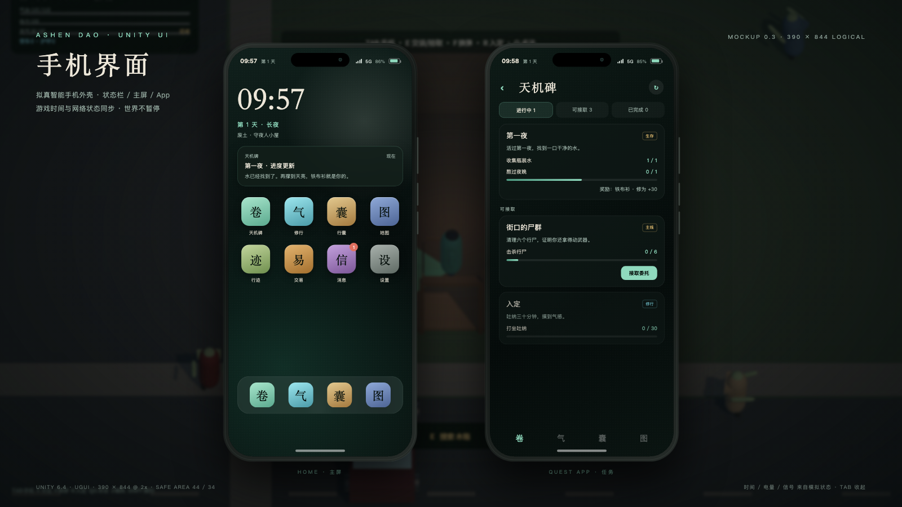

# 劫余问道 · Unity 6.4

2.5D 俯视生存 + 修仙 + 任务 + 手机式 UI 的 Unity 主工程。

## 快速开始

1. Unity Hub 添加本目录 `unity/AshenDao`。
2. 使用 **6000.4.2f1**（Unity 6.4）打开；URP 包会自动解析。
3. 打开 `Assets/Scenes/SampleScene.unity`，按 Play。

无需手动搭场景：`Bootstrap` 会在场景加载后创建 `GameRoot`，再由它生成小镇、玩家、相机、灯光、视野和 UI。



## 操作

| 键 | 行为 |
| --- | --- |
| WASD | 相对相机移动 |
| Shift | 疾行 |
| 左键 | 挥击 |
| E | 搜索/采集 |
| R | 入定/收功 |
| Q / 1 | 施放第一个主动术法 |
| Tab | 手机 |
| Esc | 关闭手机 |
| F | 换弹 |
| 2 / 3 | 御风步 / 踏云诀 |
| F5 / F9 | 存档 / 读档 |
| F8 | 删除存档并重新开始 |

## 已实现

- 固定正交 53° 俯视相机，平滑跟随、滚轮缩放
- 4 栋可进入建筑：外立面、门洞、室内家具、屋顶/南墙淡出、室内灯
- 视野：46 射线扇形 + Spot Light + AI Linecast 感知
- 玩家移动/近战/枪械/受击/死亡；11 个不同星级僵尸（行尸/疾行/警尸/军尸/猎尸/巨尸）
- 修为、灵气、道心、破境、功法等级与悟性升级；7 条任务链
- 手机 UI：状态栏、主屏、任务/修行/背包/地图/行迹/交易/消息/设置
- NPC：阿禾（守夜人，跟随/等待/安全屋）、老陈（杂货商，交易/传闻）
- 剧情：第一夜 → 诊所的路 → 古井线索；对话分支/故事标记/护送
- 声源：脚步/近战/撕咬/换弹/枪声；半径吸引僵尸，NPC 警觉
- 掉落：枪械/弹药/衣物/晶核；拾取物；装备/护甲
- 交易：天机碑收晶核，老陈收旧币；买卖/库存
- 统计/事件时间线；存档（统计、NPC、功法等级、弹匣、故事标记）

## 代码结构

```
Assets/
  Scenes/SampleScene.unity     # 模板场景；运行时由 Bootstrap 接管
  Scripts/
    Sim/                       # 纯 C# 模拟（无 UnityEngine 依赖）
      Content.cs               # 内容定义 + Demo 数据
      WorldSim.cs              # 时间/需求/灵气/修为/破境/物品
      QuestSystem.cs           # 任务接取/进度/奖励
      SaveData.cs              # 存档 DTO
    Game/
      GameRoot.cs              # 启动、输入、保存、系统装配
      Bootstrap.cs             # RuntimeInitializeOnLoadMethod
      WorldBuilder.cs          # 程序化小镇/建筑/道具/僵尸
      PlayerController.cs      # 移动/攻击/交互/术法/入定
      ZombieAI.cs              # 感知/追击/攻击/死亡
      VisionController.cs      # 视野扇形 + 手电 + CanSee
      BuildingController.cs    # 进入室内 → 屋顶/前墙淡出
      MaterialFactory.cs       # URP Lit/透明/发光材质
      DayNightController.cs    # 太阳/环境光/雾/灯光
      SaveSystem.cs            # persistentDataPath JSON 存档
    UI/
      UiFactory.cs             # UGUI 构建、圆角、字体、滚动
      PhoneUI.cs               # 手机外壳/主屏/状态栏
      PhoneApps.cs             # 任务/修行/背包/地图/消息/设置
      HudUI.cs                 # 气血/体力/灵气、提示、死亡
  Resources/Fonts/             # Noto Sans SC 子集（OFL）+ 许可证
```

## 校验（无需 Unity 许可证）

```bash
./tools/unity-check/test-sim.sh   # 16 项玩法断言
UNITY_APP=/path/to/Unity.app ./tools/unity-check/check.sh   # 0 error 编译校验
```

已在 Unity 6.4 Play Mode 跑通：GameRoot/玩家/4 栋建筑/11 个僵尸/2 个 NPC，对话/交易/行迹/枪械/功法/掉落/统计均验证。当前编译 **0 warning / 0 error**，纯 C# 断言 **52/52**，Play Mode 冒烟 **0 个游戏错误**。

首次在别的机器打开时请重点确认：

1. URP 管线与 SampleScene 正常；
2. 手机中文显示（字体资源导入）；
3. 屋顶/前墙透明淡出在 URP 下的效果；
4. 相机手感与交互距离；
5. 若模板依赖报错，检查 `Packages/manifest.json` 的内置模块与 Input System 版本（本工程已移除不兼容的 Input System 1.12）。

## 文档

- [Unity 落地方案](../../docs/UNITY.md)
- [可扩展系统（8 点）](../../docs/SYSTEMS.md)
- [故事脚本竖切片](../../docs/STORY_SCRIPT.md)
- [Unity 素材规格](../../docs/UNITY_ASSET_SPEC.md)
- [手机 UI 设计稿](../../docs/phone-ui-mockup.html) / [截图](../../docs/screenshots/phone-ui.png)
